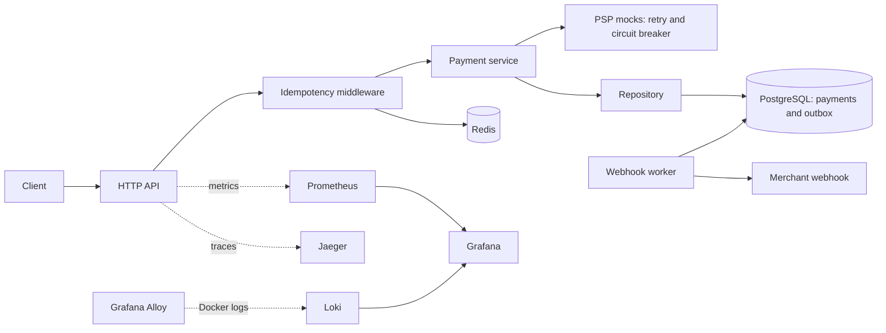

# PayFlowMock

PayFlowMock is a Go application for tests of payment integrations. It provides an HTTP API and local payment service provider (PSP) mocks.
PostgreSQL stores payment records. Redis stores cached responses and request locks. A background worker sends payment events to merchant webhooks.

The application uses Stripe and Razorpay mocks. It does not send payments to real providers.

> Writing target: approximately 80% alignment with [ASD-STE100 Simplified Technical English](https://www.asd-ste100.org/).
> This README uses short sentences, active voice, and direct instructions. Technical names and code retain their original form.
> The percentage is a style target, not a measured compliance score.

## Features

- Create payments in `USD`, `EUR`, `GBP`, or `INR`.
- Send `INR` charges to `razorpay_mock`.
- Send `USD`, `EUR`, and `GBP` charges to `stripe_mock`.
- Make up to three charge attempts for temporary PSP errors.
- Increase the retry delay exponentially and add a random delay (full jitter).
- Protect each PSP with a separate circuit breaker.
- Store payment changes and webhook events in the same database transaction.
- Replay stored HTTP responses when a client repeats an idempotency key.
- Export JSON logs, Prometheus metrics, and OpenTelemetry traces.

Five consecutive failures open a circuit breaker. After 30 seconds, the circuit breaker permits up to three probe requests.
Payment IDs and outbox event IDs use UUID v7.

## Architecture



## Start the full stack

Install Docker with Compose. Install Make to use the commands below.
Go is necessary only for development and tests on the host. The module requires Go 1.25.4 or later.

1. Create the local configuration file. If `.env` already exists, edit that file.

   ```bash
   cp .env.example .env
   ```

2. Set a PostgreSQL password in `.env`.
   Use the same credentials in `POSTGRES_USER`, `POSTGRES_PASSWORD`, `POSTGRES_DB`, and `DATABASE_URL`.

3. Add this migration path to `.env`:

   ```dotenv
   MIGRATIONS_PATH=/app/migrations/up
   ```

   The Docker image contains migration files in this directory.
   The image default points to `/app/migrations`, so this override is necessary.

4. Start the stack:

   ```bash
   make stack-up
   ```

   Compose starts PostgreSQL, Redis, the API, Jaeger, Prometheus, Loki, Grafana Alloy, and Grafana.
   The API applies database migrations at startup.

5. Check the API:

   ```bash
   curl -sS http://127.0.0.1:8080/healthz
   ```

   Expected response:

   ```json
   {"status":"ok"}
   ```

6. Stop the stack after use:

   ```bash
   make stack-down
   ```

Keep `PORT=8080` for this procedure. The Compose port mapping uses container port `8080`.

### Service addresses

| Service | Address | Purpose |
| --- | --- | --- |
| API | http://127.0.0.1:8080 | Payment requests and health checks |
| Jaeger | http://127.0.0.1:16686 | Trace search |
| Prometheus | http://127.0.0.1:9090 | Metrics and queries |
| Loki | http://127.0.0.1:3100 | Log storage API |
| Alloy | http://127.0.0.1:12345 | Collector status |
| Grafana | http://127.0.0.1:3000 | Dashboards; default login: `admin` / `admin` |

Grafana loads the Prometheus and Loki data sources automatically.
It also loads the **PayFlow** dashboard from `deploy/grafana/dashboards/payflow.json`.

## Run the API on the host

1. Create or edit `.env` as described above.
2. Remove the Docker `MIGRATIONS_PATH` override, or set it to `migrations/up`.
3. Set the trace endpoint for the host:

   ```dotenv
   OTEL_EXPORTER_OTLP_ENDPOINT=http://127.0.0.1:4318
   ```

4. Start PostgreSQL and Redis:

   ```bash
   make up
   ```

5. Start Jaeger if you need local traces:

   ```bash
   docker compose up -d jaeger
   ```

6. Start the API:

   ```bash
   make run
   ```

The server loads `.env`. Existing process environment variables take precedence.
Both PostgreSQL and Redis must respond during startup.

## Configuration

Use [`.env.example`](.env.example) as the configuration reference.

| Variable | Purpose and default |
| --- | --- |
| `DATABASE_URL` | Required PostgreSQL connection string. |
| `POSTGRES_USER`, `POSTGRES_PASSWORD`, `POSTGRES_DB` | Credentials and database name for Compose PostgreSQL. |
| `REDIS_ADDR` | Redis address. Default: `127.0.0.1:6379`; Compose uses `redis:6379`. |
| `PORT` | HTTP port. Default: `8080`. |
| `MIGRATIONS_PATH` | Migration directory. Host default: `migrations/up` when present; otherwise `migrations`. |
| `TEST_DATABASE_URL` | Connection string for a separate test database. |
| `IDEMPOTENCY_REQUEST_TIMEOUT` | PostgreSQL request lease duration. Default: `60s`. |
| `MERCHANT_WEBHOOK_URLS` | Comma-separated `merchant-uuid=https://endpoint` entries. Invalid entries are ignored. |
| `DEFAULT_WEBHOOK_URL` | Webhook URL when no merchant entry matches. |
| `WEBHOOK_SIGNING_SECRET` | Optional shared secret for HMAC-SHA256 signatures. |
| `WEBHOOK_POLL_INTERVAL` | Worker poll interval. Default: `5s`. |
| `OTEL_EXPORTER_OTLP_ENDPOINT` | OTLP/HTTP trace endpoint. Default: `jaeger:4318`. |
| `OTEL_SERVICE_NAME` | Trace service name. Default: `payflow`. |
| `OTEL_TRACES_SAMPLER_ARG` | Trace sampling ratio from `0` to `1`. Default: `1.0`. |
| `OTEL_SERVICE_VERSION` | Trace service version. Default: `dev`. |
| `OTEL_DEPLOYMENT_ENV` | Trace deployment environment. Default: `dev`. |
| `LOG_LEVEL` | Zerolog level from `trace` to `disabled`. Default: `info`. |
| `GRAFANA_ADMIN_USER`, `GRAFANA_ADMIN_PASSWORD` | Grafana credentials. Defaults: `admin` / `admin`. |

Set the idempotency lease duration longer than the slowest request that changes data.
The server does not enforce `API_KEY`, although the example configuration and Postman collection contain it.

## HTTP API

| Method | Path | Result |
| --- | --- | --- |
| `POST` | `/v1/payments` | Create and charge a payment. Returns HTTP `201`. |
| `GET` | `/v1/payments/{id}` | Get a payment. An unknown UUID returns HTTP `404`. |
| `POST` | `/v1/payments/{id}/refund` | Refund a successful payment. Returns HTTP `200`. |
| `GET` | `/healthz` | Check PostgreSQL. Returns HTTP `200` or `503`. |
| `GET` | `/metrics` | Get Prometheus metrics. |

A declined charge can return HTTP `201` with payment status `failed`.
Always examine the payment status in the response.
Errors use this structure:

```json
{"error":{"code":"VALIDATION_ERROR","message":"..."}}
```

### Create a payment

Send a merchant UUID, amount, currency, and body idempotency key.
Use a positive integer amount in minor currency units, such as cents or paise.
The amount must fit in a signed 64-bit integer. Send a JSON number, not a string.

```bash
curl -sS -X POST http://127.0.0.1:8080/v1/payments \
  -H 'Content-Type: application/json' \
  -H 'Idempotency-Key: demo-create-1' \
  -d '{
    "merchant_id": "550e8400-e29b-41d4-a716-446655440000",
    "amount": 100,
    "currency": "USD",
    "idempotency_key": "payment-001"
  }'
```

Example response:

```json
{"payment_id":"<uuid-v7>","status":"success"}
```

Payment statuses are `initiated`, `processing`, `success`, `failed`, and `refunded`.

### Get a payment

Set `PAYMENT_ID` to the UUID from the create response:

```bash
PAYMENT_ID='replace-with-payment-uuid'
curl -sS "http://127.0.0.1:8080/v1/payments/${PAYMENT_ID}"
```

The response contains the stored payment details.
This endpoint returns `amount` as a decimal string because the domain model uses `big.Int`.

### Refund a payment

Use a payment with status `success`. Send a positive amount and the original currency.
The refund amount cannot exceed the original payment amount.

```bash
curl -sS -X POST "http://127.0.0.1:8080/v1/payments/${PAYMENT_ID}/refund" \
  -H 'Content-Type: application/json' \
  -H 'Idempotency-Key: demo-refund-1' \
  -d '{"amount":100,"currency":"USD","idempotency_key":"refund-001"}'
```

Example response:

```json
{"refund_id":"<uuid>","status":"success"}
```

The transaction inserts the refund record and changes the payment status to `refunded`.
Even a refund below the original amount changes the entire payment status to `refunded`.
The HTTP refund service does not call the PSP refund adapter.

### Repeat a request safely

Send `Idempotency-Key` or `X-Idempotency-Key` to enable HTTP response replay.
This applies to `POST`, `PUT`, `PATCH`, and `DELETE` requests.
The middleware stores the response status, headers, and body for 24 hours.
A repeated key with a different method, path, or body returns HTTP `409`.

Redis provides the response cache and distributed lock.
PostgreSQL stores completed responses and provides a request lease if Redis becomes unavailable.
Redis must still respond during application startup.

The header key and the body `idempotency_key` have separate purposes.
The body key is required for payment creation and refunds.
Without the header, the middleware does not replay HTTP responses.

## Webhooks

Payment state changes create `payment.success`, `payment.failed`, or `payment.refunded` events.
The database stores each event in `outbox_events` in the same transaction as the state change.

The worker uses these defaults:

| Setting | Value |
| --- | --- |
| Poll interval | 5 seconds |
| Events claimed per batch | 20 |
| Concurrent deliveries | 8 |
| HTTP timeout | 10 seconds |
| Maximum attempts | 10 |
| Maximum retry delay | 10 minutes |
| Stale processing threshold | Two poll intervals |

Retry delays increase exponentially and include a random delay.
The worker marks an event `DEAD` after all delivery attempts fail.
It also marks an event `DEAD` if no webhook URL is configured.

Each request contains these headers:

- `Content-Type: application/json`
- `X-PayFlow-Event-Id`
- `X-PayFlow-Event-Type`
- `Idempotency-Key`, set to the event UUID
- `X-PayFlow-Signature: sha256=<hex>`, when a signing secret is configured

The JSON envelope contains `id`, `type`, `created_at`, and `data`.
The event data includes payment details and PSP metadata. Refund events also include refund metadata.

To test delivery locally:

1. Start the Python receiver:

   ```bash
   make webhook-sink
   ```

2. Set `DEFAULT_WEBHOOK_URL` in `.env`.
   For a host API, use `http://127.0.0.1:9999/webhook`.
   For Docker Desktop, use `http://host.docker.internal:9999/webhook`.
   Other Docker environments need a receiver address that the API container can reach.
3. Restart the API with the new configuration.
4. Create a payment and examine the receiver output.

## Logs, metrics, and traces

The API writes JSON logs to standard output. Logs contain `request_id`.
Logs also contain `trace_id` and `span_id` when a valid trace is active.
OpenTelemetry records HTTP, service, PSP, database, Redis, and webhook operations.

### Prometheus metrics

| Metric | Type | Labels |
| --- | --- | --- |
| `payflow_http_requests_total` | Counter | `route`, `method`, `status` |
| `payflow_http_request_duration_seconds` | Histogram | `route`, `method` |
| `payflow_payments_total` | Counter | `status` |
| `payflow_payment_latency_seconds` | Histogram | `psp` |
| `payflow_psp_attempts_total` | Counter | `psp`, `op`, `outcome` |
| `payflow_psp_retry_attempts_total` | Counter | `outcome` |
| `payflow_psp_circuit_state` | Gauge | `psp`; `0` closed, `1` half-open, `2` open |
| `payflow_webhook_delivery_attempts_total` | Counter | `outcome` (`success`, `retry`, `dead`, `error`) |
| `payflow_webhook_delivery_latency_seconds` | Histogram | none |
| `payflow_outbox_pending` | Gauge | none |
| `payflow_idempotency_cache_total` | Counter | `result` |

Go runtime and process collectors (`go_*`, `process_*`) are also registered. Example queries:

```promql
histogram_quantile(0.95, sum by (le, route) (rate(payflow_http_request_duration_seconds_bucket[5m])))

sum by (psp) (rate(payflow_psp_attempts_total{outcome="retryable_error"}[1m]))

histogram_quantile(0.95, sum(rate(payflow_webhook_delivery_latency_seconds_bucket[5m])) by (le))
```

### Find traces and logs

In Jaeger, select the service named by `OTEL_SERVICE_NAME`.
Search for `payment.create`, `payment.refund`, `psp.charge`, or `webhook.deliver`.

In Grafana, open **Explore** and select **Loki**. Use these queries:

```logql
{service="app"}
{service="app"} |= "trace_id"
{service=~"app|postgres|redis|jaeger|prometheus|loki|alloy|grafana"}
```

Grafana Alloy collects logs from the `payflowmock-*` Docker containers.
Labels include `service`, `container`, `compose_project`, and `job`.
Alloy does not collect host API logs.

## Build and test

Build the host binary:

```bash
make build
```

The output file is `bin/server`.
Docker builds use `vendor/` for Go dependencies. Run `make vendor` after dependency changes.
Optional build certificates go in `deploy/docker/extra-ca/` as `*.crt` files.

Run unit tests without database or Redis integration paths:

```bash
make test-unit
```

For integration tests, create a separate PostgreSQL database.
Set `TEST_DATABASE_URL` in `.env` to that database.
Tests apply migrations and clear application tables. Never use the development database for these tests.
Remove the Docker migration path override before host tests.
Start Redis for integration tests that exercise Redis idempotency.

```bash
make up
make test-integration
make test-week3-integration
```

`make test-integration` covers repository, handler, and middleware integration tests.
`make test-week3-integration` covers the webhook worker.
Tests that require `TEST_DATABASE_URL` are skipped when the variable is unset.

Run all tests, including integration tests, with:

```bash
make test
```

The test targets above enable the Go race detector.

### Other Make targets

Run `make help` for the complete list.

| Target | Purpose |
| --- | --- |
| `stack-up` / `stack-down` | Build and start, or stop, the full Compose stack. |
| `up` | Start PostgreSQL and Redis. |
| `down` | Stop and remove the Compose stack containers. |
| `postgres-up` / `postgres-down` | Start or stop PostgreSQL. |
| `redis-up` / `redis-down` | Start or stop Redis. |
| `logs` | Read Compose logs. Use `SERVICES="app grafana"` to select services. |
| `docker-build` | Build the application image. |
| `vendor` | Update vendored Go dependencies. |
| `run` | Run the API on the host. |
| `clean` | Remove `bin/`. |
| `test-week2-unit` | Test retry, PSP, and service packages without integration paths. |
| `test-week2-integration` | Test idempotency middleware with PostgreSQL and Redis. |
| `test-week3-unit` | Test merchant and domain packages without integration paths. |
| `migrate-up` / `migrate-down` | Apply migrations or roll back one migration with the `migrate` CLI. |
| `install-migrate` | Install the PostgreSQL-enabled migration CLI. |
| `webhook-sink` | Start the Python webhook receiver. Default port: `9999`. |

Set `WEBHOOK_SINK_PORT` to change the receiver port.

## Postman collection

Import [PayFlowMock.postman_collection.json](postman/PayFlowMock.postman_collection.json) into Postman.
The collection contains health checks, metrics, payments, refunds, validation cases, and idempotency replay requests.
It stores created payment and refund IDs in collection variables.
It also contains example webhook envelopes.

## Project layout

- `cmd/server` — startup, migrations, dependency wiring, HTTP server, OTel, and webhook worker lifecycle.
- `internal/domain` — payment, refund, status-transition, and outbox models.
- `internal/handler` — HTTP decoding, response encoding, and error mapping.
- `internal/service` — payment validation, PSP charge orchestration, retries, and refund use case.
- `internal/repository` — PostgreSQL persistence and transactional outbox writes.
- `internal/psp` — PSP contracts, Stripe/Razorpay mocks, routing, and circuit breakers.
- `internal/middleware` — request logging, metrics, and distributed idempotency.
- `internal/worker`, `internal/merchant` — webhook polling/delivery and environment-based merchant registry.
- `pkg/logger`, `pkg/metrics`, `pkg/tracer` — observability building blocks.
- `migrations/up`, `migrations/down` — PostgreSQL migration files.
- `deploy/prometheus`, `deploy/grafana`, `deploy/loki`, `deploy/alloy` — metrics, dashboards, datasources, and log shipping.
- `scripts/webhook_sink.py` — local webhook receiver.
- `Dockerfile`, `docker-compose.yml`, `Makefile` — build, stack, and development workflows.

## Current limits

- The HTTP server has no authentication middleware. It does not enforce `API_KEY`.
- Refund requests update local records and create events. They do not call a PSP refund method.
- A partial refund sets the payment status to `refunded`. Further refunds require the payment status to be `success`.
- The default PSP mocks have no artificial delay or failure rate. Change code or test configuration to simulate these conditions.
